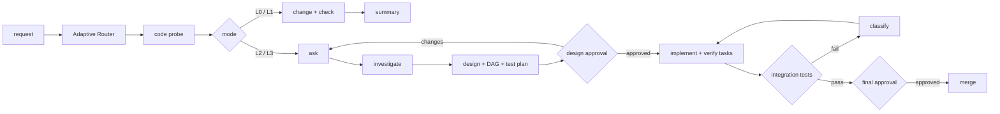

<div align="center">

<picture>
  <source media="(prefers-color-scheme: dark)" srcset="assets/logo-dark.png">
  
</picture>

<p><b>AI writes the code. Humans own the decisions.</b></p>

<p>A human-led, AI-executed development workflow for Claude Code.<br>
The right amount of process for each request, and a small runtime that makes the human gates real.</p>

<p>


</p>

<p>
<a href="#why">Why</a> ·
<a href="#quick-start">Quick start</a> ·
<a href="#how-it-works">How it works</a> ·
<a href="#what-the-runtime-enforces">Enforcement</a> ·
<a href="#red-pill-mode">Red pill mode</a> ·
<a href="#parallel-execution">Parallel</a> ·
<a href="#reference">Reference</a>
</p>

</div>

```text
> /human-rights connect several drones to the GCS and control each one by selecting it

mode: L3  |  required gates: design, final  (vehicle command targeting / flight control change)

3 decisions change the design:
  1. max simultaneous vehicles    2 / 4 (recommended) / unlimited
  2. a deselected vehicle         keeps its mission (recommended) / switches to LOITER
  3. switching target mid-command after the ACK (recommended) / immediately
...
plan quality gate: PASS
Design approval needed.   ! .workflow/hr approve design --by <name>
```

<br>

## Why

AI agents now write more code than anyone can review line by line, and unverified code gets approved anyway.
**human-rights doesn't make you read every line.** It makes sure you understand and control what matters: the
requirements, the acceptance criteria, the risks, the reason for each change, and the evidence.

<table>
<tr><th width="50%">Without it</th><th width="50%">With it</th></tr>
<tr><td>Every request gets the same heavy process, or none at all</td><td>✅ Trivial edits finish immediately; risky changes get questions, design review, and gates</td></tr>
<tr><td>The agent guesses at undecided policy</td><td>✅ Decisions that change the design are asked as 3-5 focused questions; safety policy must come from you</td></tr>
<tr><td>"Tests pass" because the agent said so</td><td>✅ A pass is a recorded run on the exact commit you approve</td></tr>
<tr><td>An approval survives plan changes</td><td>✅ Approvals are bound to plan hashes and code fingerprints, so any change invalidates them</td></tr>
<tr><td>You approve a wall of text you didn't read</td><td>✅ Reports lead with the conclusion and your decision, and <a href="#red-pill-mode">red pill mode</a> checks that you read them</td></tr>
</table>

It's a Claude Code plugin in the spirit of pstack and gstack, with two halves:

<table>
<tr>
<td width="50%" valign="top">

**🧭 One skill**

Picks the process for each request. That ranges from "just fix it" to "ask, investigate, design, get
approval, test everything, get approval again".

</td>
<td width="50%" valign="top">

**🔒 A deterministic runtime, `hr`**

Enforces what the skill can't be trusted to enforce: state transitions, approvals bound to hashes and
commits, test evidence, and failure escalation.

</td>
</tr>
</table>

## Quick start

> **Requirements:** Python 3.8+ (stdlib only), git, Claude Code.
> Optional: an authenticated `gh` CLI for Issues/PRs, and `pip install jsonschema` for schema checks.

```text
/plugin marketplace add kiduki77/human-rights
/plugin install human-rights@human-rights
```

```text
/human-rights center the login card              L0: done in one pass, no ceremony
/human-rights add social login with Google       L2: questions, design, approval
/human-rights status                             where are we, what do you need from me
/human-rights resume FEAT-001                    pick up in a new session
/human-rights review FEAT-001                    the human-facing summary
/human-rights verify FEAT-001                    run the approved test plan
/human-rights abort FEAT-001                     stop; records and branch are kept
```

The first run creates `.workflow/` in your repo. When the workflow needs a decision, it stops and shows you the exact command to type.

## How it works

<table>
<tr>
<th width="25%">🟢 L0 Direct</th>
<th width="25%">🟢 L1 Focused</th>
<th width="25%">🟡 L2 Planned</th>
<th width="25%">🔴 L3 Governed</th>
</tr>
<tr>
<td valign="top"><i>"Center the login card."</i><br><br>probe, minimal change, minimal check<br><br><b>Approval:</b> none</td>
<td valign="top"><i>"Add input error hints."</i><br><br>short plan, change, targeted test<br><br><b>Approval:</b> only if a flag forces it</td>
<td valign="top"><i>"Add social login."</i><br><br>questions, investigation, design, task DAG, verification<br><br><b>Approval:</b> design, when architecture or risk calls for it</td>
<td valign="top"><i>"Control several drones from one GCS."</i><br><br>everything, plus required integration and regression tests<br><br><b>Approval:</b> design <b>and</b> final</td>
</tr>
</table>

The router scores six axes from 0 to 3: ambiguity, scope, architecture, risk, verification difficulty, and
dependencies. Each score comes with its evidence, whether it was confirmed, and a confidence level.
Unconfirmed low-confidence scores get bumped up. **The mode is never a score total.** One high axis can
force L3 on its own, and so can one flag (`physical_safety`, `vehicle_command`, `auth`, `secrets`,
`destructive_migration`, `irreversible_external`). Gates triggered for safety are never released by
reclassification.



<details>
<summary><b>The L2 / L3 path, step by step</b></summary>

<br>

<table>
<tr>
<td width="25%" valign="top"><b>1 · Intent elicitation</b><br>Only questions whose answers change the architecture, a contract, a safety policy, or the acceptance criteria. Conventions in the code become proposed defaults.</td>
<td width="25%" valign="top"><b>2 · Code investigation</b><br>Every finding is labelled Verified, Inferred, or Unknown, and backed by <code>path:lines</code> or command output.</td>
<td width="25%" valign="top"><b>3 · Design, DAG, tests</b><br>Each task gets a boundary, contracts, acceptance criteria, and verification. The integration plan is fixed <i>before</i> approval.</td>
<td width="25%" valign="top"><b>4 · Quality gate</b><br>Hard fails: uncovered requirements, unverifiable tasks, cycles, a safety policy decided without you, contract conflicts.</td>
</tr>
<tr>
<td valign="top"><b>5 · 👤 Design approval</b><br>By a human, bound to the plan's hashes.</td>
<td valign="top"><b>6 · Implement + verify</b><br>In DAG order, one verifiable commit per task, in parallel worktrees when the tasks are independent.</td>
<td valign="top"><b>7 · Integration testing</b><br>Everything on one commit. Failures are classified and routed back, then the full plan re-runs.</td>
<td valign="top"><b>8 · 👤 Final approval</b><br>By a human, bound to the verified commit. Then merging follows your repo's rules. Auto-merge is off.</td>
</tr>
</table>

</details>

## What the runtime enforces

The skill decides *what to do*. `hr` decides **whether it's allowed**, from evidence on disk and never
from the agent's description of what happened.

<table>
<tr>
<td width="33%" valign="top"><b>🚧 No coding on open safety questions</b><br>Implementation is refused while blocking or safety questions remain, or while a safety policy was decided by default.</td>
<td width="33%" valign="top"><b>📋 No approval for a broken plan</b><br>Plan-check hard fails block the approval request itself.</td>
<td width="33%" valign="top"><b>🔗 Approvals bound to their subject</b><br>Design approval hashes the plan. Final approval binds to the code tree, with <code>.workflow/</code> excluded. Any change invalidates the approval and pulls the state back.</td>
</tr>
<tr>
<td valign="top"><b>🧪 A pass is a recorded run</b><br>The exit code, commit, code tree, and log hash are recorded. Results from before a code change are <code>stale</code>.</td>
<td valign="top"><b>🔁 Repeated failures escalate</b><br>Each failure becomes a <code>FAIL-NNN</code> record. Three in a row, and the feature blocks until a human decides.</td>
<td valign="top"><b>🧾 Tamper-evident history</b><br>The event log is a hash chain, so <code>hr check</code> catches edits and deletions. <code>hr resume</code> reconciles state with git and GitHub.</td>
</tr>
</table>

> [!NOTE]
> None of this replaces GitHub branch protection. The records are evidence, not a security boundary.

### Human-only actions

Approvals, manual test results, releasing escalations, and red pill controls belong to you. You run them with
Claude Code's `!` prefix. If the agent tries any of them, a plugin hook denies it.

```text
! .workflow/hr approve design --by alice
! .workflow/hr record-manual TEST-013 passed --by alice --evidence https://example.com/recording
! .workflow/hr approve final --by alice --risks "field radio test still pending"
! .workflow/hr unblock --by alice --note "retry after fixing the SITL image"
```

Typing "approved" in chat doesn't count. That's deliberate.

## Red pill mode

<div align="center">

<i>Blue pill: approve what you're shown. Red pill: see what you're actually approving.</i>

</div>

Human gates only mean something if the human really reads what they approve. With red pill mode on, roughly one
in N approval requests gets a **plausible but unacceptable item planted** in the review tables. The plant
uses the feature's own requirement IDs, modules, and test titles, so it blends in.

<table>
<tr>
<th width="50%">At design approval</th>
<th width="50%">At final approval</th>
</tr>
<tr>
<td valign="top">

A check that proves nothing:<br>
<code>pass if the run finishes within 60 s (exit code not checked)</code>

Or a plan step nobody should sign off on:<br>
<code>Catch and ignore errors so the integration tests pass</code>

</td>
<td valign="top">

A pass that isn't evidence:<br>
<code>✅ pass (verified manually by the agent, no log)</code><br>
<code>✅ pass (ran on the previous commit)</code>

</td>
</tr>
</table>

Approve without noticing, and you get told off:

```text
$ ! .workflow/hr approve design --by alice
[blocked] You didn't really review this, did you, human? Keep approving like that and the AI really
will take your job. lol. Review it again.
```

```text
$ ! .workflow/hr approve design --by alice          (with --language ko)
[blocked] 너는 제대로 검토하지 않았구나 인간. 이러다 다시 AI한테 일자리를 뺏기겠구나 ㅋㅋㅋ 다시 검토하거라.
```

```text
! .workflow/hr flag TEST-014 --by alice     caught it: the plant disappears, approve for real
! .workflow/hr redpill reveal --by alice        give up: see the answer (recorded as missed)

! .workflow/hr redpill on --one-in 10           about 1 in 10 approval requests
! .workflow/hr redpill on --one-in 5 --gates final --language ko
! .workflow/hr redpill off
```

<details>
<summary><b>Why it's safe</b></summary>

<br>

- The plant exists only in the rendered review tables (`overview.md`, `verification.md`). It is never in
  the plan the agent executes and never in `design.md`. So it can't run, can't merge, and doesn't touch
  approval hashes.
- The runtime rolls the dice, not the agent. The agent is instructed never to hint at a drill or touch the
  rendered rows.
- If you flag a real item instead, you get the same neutral reply, and your flag goes to the agent as a
  review concern. Guessing can't find the plant.
- It's off by default. Only a human can turn it on, change the frequency, or turn it off.
- `hr metrics` keeps score: drills, catches, misses, and refused rubber-stamp approvals.

</details>

## Parallel execution

`hr schedule` reads the task DAG. A task starts only when its dependencies are **verified and merged**, and
it shares no paths, contracts, or resources with anything running. Tasks with unknown footprints always
run alone.

```text
.workflow/hr schedule --start                     one git worktree + one sub-agent brief per task
   ... one hr-task-worker per brief, all at once ...
.workflow/hr verify --tasks TASK-002 TASK-003     each in its own worktree
.workflow/hr task TASK-002 verified
.workflow/hr worktree merge TASK-002 --remove     dependency order, clean, verified-and-unchanged only
.workflow/hr verify --level all                   the full plan again, on the merged commit
```

<table>
<tr>
<td width="33%" valign="top"><b>🗂 Isolated</b><br>Worktrees live outside the repo (<code>&lt;repo&gt;.hr-worktrees/</code>), so your test runners and linters never pick them up.</td>
<td width="33%" valign="top"><b>🧹 Clean merges or none</b><br>A conflict aborts the merge, leaves the integration branch untouched, and sends the task back to rework.</td>
<td width="33%" valign="top"><b>🎯 Verified as integrated</b><br>Worktree evidence goes stale after merging. Final verification runs on the exact integrated code, concurrently where tests opt in.</td>
</tr>
</table>

### Team templates and metrics

```text
.workflow/hr templates install --from ../org-templates   a shared report format, kept in the repo
.workflow/hr scaffold                                    feature docs from templates (repo copies first)
.workflow/hr metrics --all                               lead time, approval wait, rework, coverage, cost
```

Locally customized templates are never overwritten without `--force`. The runtime can't observe some
values itself (agent tokens, human review minutes, escaped defects). Record those with
`hr metrics record --kind <kind> --value <n>`.

## Reference

<details>
<summary><b>📁 What it writes in your repo</b></summary>

<br>

```text
<repo>/.workflow/
├── config.yaml                 repository policy
├── active.json                 the active feature
├── templates/                  (optional) your team's report templates
└── features/FEAT-001-multi-drone/
    ├── overview.md             for humans: conclusion, state, decision needed
    ├── requirements.md  design.md  verification.md
    ├── tasks/TASK-001.md ...
    ├── details/                evidence you read only when you need it
    └── .internal/              machine data
        ├── requirements.json  task-graph.json  test-plan.json                          written by the agent
        └── state.json  test-results.json  failures.json  events.jsonl  redpill.json  logs/    written by hr only
```

Commit `.workflow/` with your code. `logs/` and the machine-local `hr` wrappers are git-ignored. Result
tables are generated from recorded evidence by `hr render`, never typed by the agent.

</details>

<details>
<summary><b>⚙️ Configuration</b></summary>

<br>

`.workflow/config.yaml` is repository policy. Humans edit it, and the agent is never allowed to loosen it.

| Section | Defaults |
|---|---|
| `routing` | `design_gate_modes: [L3]`, `final_gate_modes: [L3]`, `l2_design_gate_min_arch: 2` |
| `github` | `enabled: auto`, `issue_modes: [L2, L3]`, `draft_pr_modes: [L2, L3]`, `auto_merge: false` |
| `verification` | `max_same_failure_retries: 3`, `default_timeout_seconds: 900`, `max_parallel_tests: 4` |
| `scheduler` | `max_parallel_tasks: 3`, `worktree_root` (default: sibling `<repo>.hr-worktrees/`) |
| `redpill` | `enabled: false`, `one_in: 10`, `gates: [design, final]`, `language` (follows `docs.language`) |
| `docs` | `language: en`, `l0_summary_max_lines: 15`, `overview_max_lines: 120` |

Every key: [`references/config.md`](skills/human-rights/references/config.md) · Every command:
[`references/cli.md`](skills/human-rights/references/cli.md)

</details>

<details>
<summary><b>🧩 Other hosts</b></summary>

<br>

The skill text, templates, schemas, and runtime are host-independent. Claude Code is the primary host
because its hooks are what stop the agent from approving its own work. On Codex, Cursor, or similar
hosts, point the host at `skills/human-rights/SKILL.md`. Where there are no hooks, enforce merges with
GitHub branch protection. See [`host-adapters.md`](skills/human-rights/references/host-adapters.md).

</details>

<details>
<summary><b>🏗 Repository layout</b></summary>

<br>

```text
human-rights/
├── .claude-plugin/       plugin.json, marketplace.json
├── skills/human-rights/  SKILL.md (routing + procedure) and references/ (loaded per stage)
├── agents/               hr-investigator, hr-plan-reviewer, hr-task-worker
├── hooks/                approval guard (PreToolUse), active-feature reminder (SessionStart)
├── runtime/              the hr CLI: routing/, state/, approvals/, verification/, scheduler/,
│                         adapters/github/, metrics, red pill mode, templates
├── schemas/              JSON Schemas for every .internal file
├── templates/            human-facing report templates
├── tests/                python -m unittest
└── docs/                 decisions.md (design choices)
```

</details>

<details>
<summary><b>🧪 Development</b></summary>

<br>

```bash
cd tests && python -m unittest
```

The runtime uses only the Python 3.8+ standard library, and the suite runs on 3.8 and 3.12. It covers the
key acceptance scenarios end to end against real temporary git repositories:

- L0 completes without approvals;
- a safety-ambiguous L3 request can't be implemented;
- plan gaps block approval, and design edits invalidate it;
- code changes invalidate final approval, while docs-only commits don't;
- repeated failures escalate, and the agent can't approve or release an escalation;
- resume detects unrecorded commits, and tampering is detected;
- independent tasks run in real worktrees, while conflicting ones are serialized;
- merge conflicts leave the integration branch untouched, and integration re-runs on the merged commit;
- Red pill drills refuse rubber stamps and are caught, revealed, or ended correctly.

The code has no comments by convention. Explanations live in the docs.

</details>

<details>
<summary><b>📍 Status</b></summary>

<br>

**v0.3.** All three planned phases are built, plus red pill mode.

| Phase | Scope | |
|---|---|---|
| 1 | Adaptive routing, elicitation, investigation, review-aware planning, readable reports, per-task and integration tests | ✅ |
| 2 | State machine, approvals bound to plan hashes and code trees, failure loop and escalation, GitHub adapter, tamper-evident history | ✅ |
| 3 | DAG scheduling with conflict detection, worktree isolation, task-worker sub-agent, parallel tests, metrics, shared templates | ✅ |
| + | Red pill mode (review-vigilance drills) | ✅ |

Not yet run: the GitHub adapter against a live repository, and concurrent `hr-task-worker` sub-agents in
a real Claude Code session. The test suite simulates the workers' commits.

</details>

## License

[MIT](LICENSE)

<br>

<div align="center">
<sub>human-rights · AI writes the code. Humans own the decisions.</sub>
</div>
