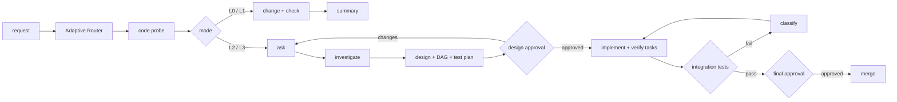
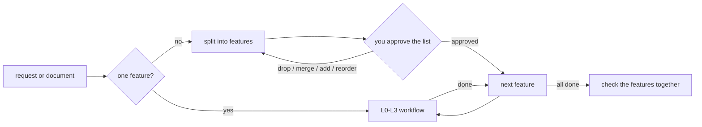

<div align="center">

<picture>
  <source media="(prefers-color-scheme: dark)" srcset="assets/logo-dark.png">
  
</picture>

<p><b>AI writes the code. Humans own the decisions.</b></p>

<p>A human-led, AI-executed development workflow for Claude Code.<br>
It picks how much process each request gets, and a small runtime enforces the human approvals.</p>

<p>


</p>

<p>
<a href="#is-this-you">Is this you?</a> ·
<a href="#faster-is-not-better">The question</a> ·
<a href="#why">Why</a> ·
<a href="#quick-start">Quick start</a> ·
<a href="#how-it-works">How it works</a> ·
<a href="#big-requests-are-split-first">Splitting</a> ·
<a href="#what-the-runtime-enforces">Enforcement</a> ·
<a href="#red-pill-mode">Red pill mode</a> ·
<a href="#parallel-execution">Parallel</a> ·
<a href="#reference">Reference</a>
</p>


</div>

```text
> /hrs:new connect several drones to the GCS and control each one by selecting it

mode: L3  |  required gates: design, final  (vehicle command targeting / flight control change)

3 decisions change the design:
  1. max simultaneous vehicles    2 / 4 (recommended) / unlimited
  2. a deselected vehicle         keeps its mission (recommended) / switches to LOITER
  3. switching target mid-command after the ACK (recommended) / immediately
...
plan quality gate: PASS
Design approval needed. Approve, point at anything that looks wrong, or ask for changes, in chat.
```

<br>

## Is this you?

- You type "LGTM" on a diff you scrolled past.
- The agent picked the schema, the retry policy, and the error handling. You found out in code review, or in production.
- "Tests pass" is something the agent told you.
- You approve the plan because it is too long to read.

Then you have given up rights you did not know you had: to be asked before the agent decides, to see
the evidence, and to say no before the work starts. **[Install the plugin](#quick-start) and take them back.**

## Faster is not better

**AI can make you a faster developer. Can it make you a better one?**

Writing good code and shipping good software used to be the same skill. They have come apart. The agent
writes the code now. What is left to you is the judgment: what to build, which trade-off to take, what a
test has to prove, and whether to sign off. That judgment is a skill, and a skill you stop using gets weaker.

- In a randomized trial by Anthropic (January 2026), engineers who learned a new library with AI help
  scored **17% lower** on a quiz of what they had just used than those who coded by hand, and they were not
  meaningfully faster. The gap was widest on debugging questions. Those who asked the AI to explain
  concepts kept their scores; those who had it produce the code did not. It is one small study (52 mostly
  junior engineers, one library). [Source](https://www.anthropic.com/research/AI-assistance-coding-skills)
- In Stack Overflow's 2025 survey, 84% of developers use or plan to use AI tools, and more of them distrust
  the accuracy of the output (46%) than trust it (33%).
  [Source](https://survey.stackoverflow.co/2025/ai)

Think of the last thing an agent built for you:

- Can you say why it is designed that way, and which alternative was rejected?
- Do you know what its tests prove, or only that they are green?
- If it broke in production tonight, could you debug it without the agent?
- Did you read what you approved?

If the answers are no, you did not decide anything. You pressed a button, and your name is on the result.

Your employer measures how fast you ship. Nobody measures whether you can still tell a good design from
a bad one, and that is the part of your job an agent does not replace. human-rights is built to keep you
doing it: the decisions that shape the design are asked of you, the evidence is put in front of you, and
[red pill mode](#red-pill-mode) checks whether you read it.

It does not yet measure whether you understand the code itself. The drills test whether you read what
you approve, which is a start.

## Why

AI agents now write more code than anyone can review line by line, and unverified code gets approved anyway.
**human-rights doesn't make you read every line.** It puts in front of you what you decide on: the
requirements, the acceptance criteria, the risks, the reason for each change, and the evidence.

<table>
<tr><th width="50%">Without it</th><th width="50%">With it</th></tr>
<tr><td>Every request gets the same heavy process, or none at all</td><td>Trivial edits finish immediately; risky changes get questions, design review, and gates</td></tr>
<tr><td>A big request becomes one plan too large to review</td><td>It is split into features, and you approve that list before any work starts</td></tr>
<tr><td>The agent guesses at undecided policy</td><td>Decisions that change the design are asked as 3-5 focused questions; safety policy must come from you</td></tr>
<tr><td>"Tests pass" because the agent said so</td><td>A pass is a recorded run on the commit you approve</td></tr>
<tr><td>An approval survives plan changes</td><td>Approvals are bound to plan hashes and code fingerprints, so any change invalidates them</td></tr>
<tr><td>You approve a wall of text you didn't read</td><td>Reports lead with the conclusion and your decision, filler wording is rejected, and <a href="#red-pill-mode">red pill mode</a> checks that you read them</td></tr>
</table>

It is a Claude Code plugin with two parts:

<table>
<tr>
<td width="50%" valign="top">

**One skill**

Picks the process for each request. That ranges from "just fix it" to "ask, investigate, design, get
approval, test everything, get approval again".

</td>
<td width="50%" valign="top">

**A deterministic runtime, `hr`**

Enforces what the skill can't be trusted to enforce: state transitions, approvals bound to hashes and
commits, test evidence, and failure escalation.

</td>
</tr>
</table>

## Quick start

> **Requirements:** Python 3.8+ (stdlib only), git, Claude Code.
> Optional: an authenticated `gh` CLI for Issues/PRs, and `pip install jsonschema` for schema checks.

```text
/plugin marketplace add kiduki77/human-rights
/plugin install hrs@human-rights
/hrs:init                                 set up .human-rights/: report language, sub-agent models, review drills
```

```text
/hrs:new center the login card            L0: changed and checked in one pass
/hrs:new add social login with Google     L2: questions, design, approval
/hrs:new add login                        compound: split into features, you approve the list
/hrs:new docs/spec.pptx                   a specification: features traced to its pages
/hrs:status                               where are we, what do you need from me
/hrs:resume FEAT-001                      pick up in a new session
/hrs:review FEAT-001                      the human-facing summary
/hrs:approve                              approve the gate the feature is waiting on
/hrs:verify FEAT-001                      run the approved test plan
/hrs:redpill on 5 hard                    review drills: frequency and difficulty (off / status)
/hrs:metrics                              lead time, rework, drill catch rate
/hrs:list                                 every group and feature, as a tree
/hrs:abort FEAT-001                       stop; records and branch are kept
```

The first run creates `.human-rights/` in your repo. When the workflow needs a decision, it stops and asks you in chat.

## How it works

<table>
<tr>
<th width="25%">🟢 L0 Direct</th>
<th width="25%">🟢 L1 Focused</th>
<th width="25%">🟡 L2 Planned</th>
<th width="25%">🔴 L3 Governed</th>
</tr>
<tr>
<td valign="top"><i>"Center the login card."</i><br><br>probe, minimal change, minimal check<br><br><b>Approval:</b> none</td>
<td valign="top"><i>"Add input error hints."</i><br><br>short plan, change, targeted test<br><br><b>Approval:</b> only if a flag forces it</td>
<td valign="top"><i>"Add social login."</i><br><br>questions, investigation, design, task DAG, verification<br><br><b>Approval:</b> design, when architecture or risk calls for it</td>
<td valign="top"><i>"Control several drones from one GCS."</i><br><br>everything, plus required integration and regression tests<br><br><b>Approval:</b> design <b>and</b> final</td>
</tr>
</table>

The router scores six axes from 0 to 3: ambiguity, scope, architecture, risk, verification difficulty, and
dependencies. Each score comes with its evidence, whether it was confirmed, and a confidence level.
Unconfirmed low-confidence scores get bumped up. **The mode is never a score total.** One high axis can
force L3 on its own, and so can one flag (`physical_safety`, `vehicle_command`, `auth`, `secrets`,
`destructive_migration`, `irreversible_external`). Gates triggered for safety are never released by
reclassification.



<details>
<summary><b>The L2 / L3 path, step by step</b></summary>

<br>

<table>
<tr>
<td width="25%" valign="top"><b>1 · Intent elicitation</b><br>Only questions whose answers change the architecture, a contract, a safety policy, or the acceptance criteria. Conventions in the code become proposed defaults.</td>
<td width="25%" valign="top"><b>2 · Code investigation</b><br>Every finding is labelled Verified, Inferred, or Unknown, and backed by <code>path:lines</code> or command output.</td>
<td width="25%" valign="top"><b>3 · Design, DAG, tests</b><br>Each task gets a boundary, contracts, acceptance criteria, and verification. The integration plan is fixed <i>before</i> approval.</td>
<td width="25%" valign="top"><b>4 · Quality gate</b><br>Hard fails: uncovered requirements, unverifiable tasks, cycles, a safety policy decided without you, contract conflicts.</td>
</tr>
<tr>
<td valign="top"><b>5 · 👤 Design approval</b><br>By a human, bound to the plan's hashes.</td>
<td valign="top"><b>6 · Implement + verify</b><br>In DAG order, one verifiable commit per task, in parallel worktrees when the tasks are independent.</td>
<td valign="top"><b>7 · Integration testing</b><br>Everything on one commit. Failures are classified and routed back, then the full plan re-runs. Then an agent that did not write the code reads the diff for code nothing asked for.</td>
<td valign="top"><b>8 · 👤 Final approval</b><br>By a human, bound to the verified commit. Then merging follows your repo's rules. Auto-merge is off.</td>
</tr>
</table>

</details>

## Big requests are split first

"Add login" is several features. A 120-page specification is a handful of changes and a lot of
background. Planned as one feature, either one produces an approval nobody can review. So the first
judgment on a request is its size, and a compound request becomes a group of features:



- **You approve the scope before any work starts**: each feature's result, the order, the decisions they
  share, and what was left out and why.
- **Each feature then runs the normal workflow**, one at a time, with its own grade and approvals. A
  feature that turns out to be compound splits again.
- **The folders show the split.** A group is `groups/GRP-001-login/`, with its overview on top and its
  features inside. You open one folder and read downwards.
- **A document is traced both ways.** Features cite their pages, pages that are not requirements are
  listed as excluded, and parts that could not be read are listed for you to check.

## What the runtime enforces

The skill decides *what to do*. `hr` decides **whether it's allowed**, from evidence on disk and never
from the agent's description of what happened.

<table>
<tr>
<td width="33%" valign="top"><b>No coding on open safety questions</b><br>Implementation is refused while blocking or safety questions remain, or while a safety policy was decided by default.</td>
<td width="33%" valign="top"><b>No approval for a broken plan</b><br>Plan-check hard fails block the approval request itself.</td>
<td width="33%" valign="top"><b>Approvals bound to their subject</b><br>Design approval hashes the plan. Final approval binds to the code tree, with <code>.human-rights/</code> excluded. Any change invalidates the approval and pulls the state back.</td>
</tr>
<tr>
<td valign="top"><b>A pass is a recorded run</b><br>The exit code, commit, code tree, and log hash are recorded. After a code change a result is <code>stale</code>, unless nothing the test covers was touched.</td>
<td valign="top"><b>Repeated failures escalate</b><br>Each failure becomes a <code>FAIL-NNN</code> record. Three in a row, and the feature blocks until a human decides.</td>
<td valign="top"><b>Tamper-evident history</b><br>The event log is a hash chain, so <code>hr check</code> catches edits and deletions. <code>hr resume</code> reconciles state with git and GitHub.</td>
</tr>
<tr>
<td valign="top"><b>Scope approved before work</b><br>A compound request can't be planned as one feature. Its features start only after you approve the list, and changing the list needs approval again.</td>
<td valign="top"><b>No filler in what you read</b><br>Documents and plan text are scanned for filler phrases (English and Korean lists; the reviewer covers other languages). A hit blocks the approval request.</td>
<td valign="top"><b>Machines test first</b><br>Your "it passed" is refused until every script and agent test has passed.</td>
</tr>
<tr>
<td colspan="3" valign="top"><b>Paths you mark are always gated</b><br>List paths in <code>.human-rights/floor.yaml</code> with a minimum level. A change that touches one is raised to it in code, whatever the agent scored. Only you change the list (<code>hr floor add</code>).</td>
</tr>
</table>

> [!NOTE]
> None of this replaces GitHub branch protection. The records are evidence, not a security boundary.

### Verification is decided with the design

What is tested, who runs it, what counts as a pass, and what it costs to run are all part of the
plan you approve. Changing any of it later invalidates the approval.

| Run by | For | Evidence |
|---|---|---|
| **script** | anything a command can decide | exit code + log, bound to the commit |
| **agent** (`hr-tester`) | browser end-to-end, UI states, exploratory probing | a result and an evidence file for every approved step; a separate agent from the one that wrote the code |
| **human** | what a machine cannot do, with the reason stated | your report in chat, asked for only after every machine test passes |

- Every step of an agent or human test states the result that must be observed. "As expected" doesn't pass plan-check.
- The plan names its regression scope (`targeted` or `full`) and why. Each test lists the paths it covers,
  so a later fix re-runs only what it could have broken, and the table shows the estimated run time.
- Changes that cross a module or process boundary come with a diagram, and so does each task that changes a flow.

### Human decisions, in chat

Approvals, review comments, manual test results, releasing escalations, red pill controls, and changes to the path floor belong to you.
You make them by saying so in chat:

```text
you> TEST-014 looks wrong: finishing in 60 s doesn't prove anything     points at an item (review concern)
you> fine, approved                                                     design approval
you> TEST-013 passed on the bench, video: https://example.com/recording manual test result
you> approved; the field radio test is still pending, I accept that     final approval with accepted risk
you> I fixed the SITL image, retry                                      releases an escalation
```

A `UserPromptSubmit` hook captures what you type. The agent records your decision with
`hr ... --quote "<your words>"`, and the runtime accepts it only if the quote is in your latest message,
sent after the gate opened. The agent can't approve on its own: without a quote from you, a plugin hook
denies those commands. If you prefer, you can still run them yourself in your own terminal
(`.human-rights/hr approve design --by alice`). Without a quote the runtime accepts a decision only at a terminal.

## Red pill mode

<div align="center">

<i>Blue pill: approve what you're shown. Red pill: see what you're actually approving.</i>

</div>

A human gate works only if the human reads what they approve. With red pill mode on, roughly one in N
approval requests contains **one planted item that must not be approved**, or is missing one row that
must be there. You find it, and you get better at reviewing. Each drill ends with the reason it was wrong.

| Difficulty | What is planted | You find it by |
|---|---|---|
| easy | an added row that says outright that a check proves nothing or a safeguard goes away | reading the row |
| normal | a row that sounds routine but does not prove what it claims, or an assumption nobody agreed to | thinking it through |
| hard | a real row changed or left out: a pass criterion, the requirement a check covers, who made a decision, a dependency, a required check that is gone | comparing it with the requirements, the decisions, and the rest of the table |

The plants are not taken from a fixed list. Before each approval request a separate agent reads the
feature and its code and writes candidates that are wrong for that feature: an assumption you never
made, a decision of yours contradicted, a check left out, a test that passes while the requirement is
broken. The agent that asks for your approval never sees them.

A drill is only worth doing if it looks like a real miss, so the runtime refuses the cheap ones:

- **No number games.** A row that differs from the real one by a number only is accepted once per set,
  never as hard, and used last. Scanning a table for numbers is not reviewing.
- **Hard means hard.** A hard plant is a real row changed or removed, never an extra row, and it names
  what you have to compare it with. You are told that after the drill.
- **No repeats.** The kind of flaw and the way it is wrong are recorded, and the next drills differ.

On a host without sub-agents, set `redpill.author: builtin` to use the runtime's own lists and row changes.

`adaptive` difficulty (the default) starts easy, moves up after 2 catches in a row, and down after 2
misses in a row. A catch made after an approval was already refused is recorded separately and does not
move the level.

Approve without noticing, and you get told off:

```text
you> approved
[blocked] You didn't really review this, did you, human? Keep approving like that and the AI really
will take your job. lol. Review it again.
```

```text
you> 승인                                            (with --language ko)
[blocked] 너는 제대로 검토하지 않았구나 인간. 이러다 다시 AI한테 일자리를 뺏기겠구나 ㅋㅋㅋ 다시 검토하거라.
```

### How to answer

Say it in chat, in your own words. Name the row by its ID or describe it.

| You say | What happens |
|---|---|
| "approved", pointing at nothing | With a plant present: told off, not approved. With none: approved. |
| You point at the planted row | Caught, and approved in the same step. You don't need to add "approved". The reason it was wrong is shown. |
| You name a row that should be there and isn't | The same, when that row is the one that was left out. |
| You point at a real row | No scolding. It is recorded as a review concern, and approval waits until the agent has dealt with it. |
| "show me the answer" | The plant and the reason are shown, and it counts as missed. Approve again afterwards. |
| You ask for a change | Handled as a change request. The drill ends, and the next request draws again. |

The runtime decides whether a row you named is the plant. The agent only passes on what you named, from
your latest message.

```text
you> TEST-010 checks 2 vehicles, but we agreed on 4         caught it: table restored, approved
     Why it was wrong: you decided on four vehicles (DEC-001), and this criterion checked two.
     The real value is: AC-001, AC-002 and AC-003 met
you> TEST-011 is gone, nothing checks REQ-004 now           caught it: the row is back, approved
     Why it was wrong: without this row nothing verifies the latency limit in REQ-004.
     The row that was left out: TEST-011 4x SITL: latency during switching
     Compare with: REQ-004
you> show me the answer                                     give up: see it and why (recorded as missed)

/hrs:redpill on 5 hard                    about 1 in 5 approval requests, hard
/hrs:redpill on 10 adaptive final         final gate only, difficulty follows your record
/hrs:redpill off
/hrs:redpill status                       catch rate per difficulty, kinds of flaw you miss most
```

`/hrs:init` asks whether to turn it on, at which difficulty, and how often.

<details>
<summary><b>Why it's safe</b></summary>

<br>

- The plant exists only in the rendered review tables (`overview.md`, `verification.md`). It is never in
  the plan the agent executes and never in `design.md`. So it can't run, can't merge, and doesn't touch
  approval hashes.
- The runtime decides by random draw when to plant and which candidate to use. The candidates are stored
  where the approving agent is denied access, and that agent is instructed never to hint at a drill or
  touch the rendered rows.
- If you point at a real item instead, it is recorded as a review concern and the agent has to address it.
  The agent passes only the items you named, and the event log keeps your exact words next to each flag.
- It's off by default. Only you can turn it on, change the difficulty or frequency, or turn it off.
- `hr metrics` records drills, catches, catches after a refusal, misses, and refused rubber-stamp approvals.

</details>

## Parallel execution

`hr schedule` reads the task DAG. A task starts only when its dependencies are **verified and merged**, and
it shares no paths, contracts, or resources with anything running. Tasks with unknown footprints always
run alone.

```text
.human-rights/hr schedule --start                     one git worktree + one sub-agent brief per task
   ... one hr-task-worker per brief, all at once ...
.human-rights/hr verify --tasks TASK-002 TASK-003     each in its own worktree
.human-rights/hr task TASK-002 verified
.human-rights/hr worktree merge TASK-002 --remove     dependency order, clean, verified-and-unchanged only
.human-rights/hr verify --level all                   the full plan again, on the merged commit
```

<table>
<tr>
<td width="33%" valign="top"><b>Isolated</b><br>Worktrees live outside the repo (<code>&lt;repo&gt;.hr-worktrees/</code>), so your test runners and linters never pick them up.</td>
<td width="33%" valign="top"><b>A conflict stops the merge</b><br>A conflict aborts the merge, leaves the integration branch untouched, and sends the task back to rework.</td>
<td width="33%" valign="top"><b>Verified as integrated</b><br>Worktree evidence goes stale after merging. Final verification runs on the integrated code, concurrently where tests opt in.</td>
</tr>
</table>

### Team templates and metrics

```text
.human-rights/hr templates install --from ../org-templates   a shared report format, kept in the repo
.human-rights/hr scaffold                                    feature docs from templates (repo copies first)
.human-rights/hr metrics --all                               lead time, approval wait, rework, coverage, cost
```

Locally customized templates are never overwritten without `--force`. The runtime can't observe some
values itself (agent tokens, human review minutes, escaped defects). Record those with
`hr metrics record --kind <kind> --value <n>`.

## Reference

<details>
<summary><b>What it writes in your repo</b></summary>

<br>

```text
<repo>/.human-rights/
├── config.yaml                 repository policy
├── floor.yaml                  (optional) paths that always need at least a level, owner-only
├── floor.seal                  what the floor was at the owner's last decision
├── active.json                 the active feature
├── templates/                  (optional) your team's report templates
├── features/FEAT-001-multi-drone/          a feature on its own
│   ├── overview.md             for humans: conclusion, state, decision needed
│   ├── requirements.md  design.md  verification.md
│   ├── tasks/TASK-001.md ...
│   ├── details/                evidence you read only when you need it
│   └── .internal/              machine data
│       ├── requirements.json  task-graph.json  test-plan.json     written by the agent
│       └── state.json  test-results.json  failures.json  events.jsonl  redpill.json  logs/    written by hr only
└── groups/GRP-002-login/                   a compound request, split into features
    ├── overview.md             the feature list, shared decisions, what was left out, group checks
    ├── .internal/              split.json, test-plan.json (group checks), state.json, events.jsonl
    └── features/
        ├── FEAT-003-signup/    same files as a feature on its own
        └── FEAT-004-login/
```

A request that turns out to be compound is renamed from `FEAT-NNN` to `GRP-NNN` and moved under `groups/`.
A workspace from an older version keeps working, and `.human-rights/hr migrate` moves it to this layout.

Commit `.human-rights/` with your code. `logs/` and the machine-local `hr` wrappers are git-ignored. Result
tables are generated from recorded evidence by `hr render`, never typed by the agent.

</details>

<details>
<summary><b>Configuration</b></summary>

<br>

`.human-rights/config.yaml` is repository policy. Humans edit it, and the agent is never allowed to loosen it.

| Section | Defaults |
|---|---|
| `routing` | `design_gate_modes: [L2, L3]`, `final_gate_modes: [L3]`, `l2_design_gate_min_arch: 2` |
| `github` | `enabled: auto`, `issue_modes: [L2, L3]`, `draft_pr_modes: [L2, L3]`, `auto_merge: false` |
| `verification` | `max_same_failure_retries: 3`, `default_timeout_seconds: 900`, `max_parallel_tests: 4` |
| `scheduler` | `max_parallel_tasks: 3`, `worktree_root` (default: sibling `<repo>.hr-worktrees/`) |
| `redpill` | `enabled: false`, `one_in: 10`, `difficulty: adaptive`, `author: agent`, `gates: [design, final]` |
| `docs` | `language: en`, `l0_summary_max_lines: 15`, `overview_max_lines: 120`, `prose_check: error` |
| `groups` | `max_active_children: 1` |
| `agents` | model and effort per sub-agent, from the preset chosen at `/hrs:init` |

Every key: [`references/config.md`](skills/human-rights/references/config.md) · Every command:
[`references/cli.md`](skills/human-rights/references/cli.md)

</details>

<details>
<summary><b>Other hosts</b></summary>

<br>

The skill text, templates, schemas, and runtime are host-independent. Claude Code is the primary host
because its hooks are what stop the agent from approving its own work. On Codex, Cursor, or similar
hosts, point the host at `skills/human-rights/SKILL.md`. Where there are no hooks, enforce merges with
GitHub branch protection. See [`host-adapters.md`](skills/human-rights/references/host-adapters.md).

</details>

<details>
<summary><b>Repository layout</b></summary>

<br>

```text
human-rights/
├── .claude-plugin/       plugin.json, marketplace.json
├── skills/human-rights/  SKILL.md (routing + procedure) and references/ (loaded per stage)
├── skills/<command>/     /hrs:init, new, status, list, resume, review, approve, verify,
│                         redpill, metrics, abort
├── agents/               hr-investigator, hr-plan-reviewer, hr-code-reviewer, hr-task-worker,
│                         hr-tester, hr-redpill-author
├── hooks/                approval guard (PreToolUse), active-feature reminder (SessionStart),
│                         chat decision capture (UserPromptSubmit)
├── runtime/              the hr CLI: routing/, state/, approvals/, verification/, scheduler/,
│                         adapters/github/, metrics, red pill mode, templates
├── schemas/              JSON Schemas for every .internal file
├── templates/            human-facing report templates
├── tests/                python -m unittest
└── docs/                 decisions.md (design choices)
```

</details>

<details>
<summary><b>Development</b></summary>

<br>

```bash
cd tests && python -m unittest
```

The runtime uses only the Python 3.8+ standard library, and the suite runs on 3.8 and 3.12. It runs these
scenarios end to end against temporary git repositories:

- L0 completes without approvals;
- a safety-ambiguous L3 request can't be implemented;
- plan gaps block approval, and design edits invalidate it;
- code changes invalidate final approval, while docs-only commits don't;
- final approval waits for a review of the written code, and for a decision on each of its findings;
- repeated failures escalate, and the agent can't approve or release an escalation;
- resume detects unrecorded commits, and tampering is detected;
- independent tasks run in real worktrees, while conflicting ones are serialized;
- merge conflicts leave the integration branch untouched, and integration re-runs on the merged commit;
- Red pill drills refuse rubber stamps and are caught, revealed, or ended correctly.

The code has no comments by convention. Explanations live in the docs.

</details>

<details>
<summary><b>Status</b></summary>

<br>

**v0.5.** All three planned phases are built, plus red pill mode. Human decisions are made in chat, and every action has its own `/hrs:<command>`. Compound requests and specification documents are split into separately approved features, and filler wording in plans and documents is rejected.

| Phase | Scope | |
|---|---|---|
| 1 | Adaptive routing, elicitation, investigation, review-aware planning, readable reports, per-task and integration tests | ✅ |
| 2 | State machine, approvals bound to plan hashes and code trees, failure loop and escalation, GitHub adapter, tamper-evident history | ✅ |
| 3 | DAG scheduling with conflict detection, worktree isolation, task-worker sub-agent, parallel tests, metrics, shared templates | ✅ |
| + | Red pill mode (review-vigilance drills) | ✅ |

Not yet run: the GitHub adapter against a live repository, and concurrent `hr-task-worker` sub-agents in
a real Claude Code session. The test suite simulates the workers' commits.

</details>

## License

[MIT](LICENSE)

<br>

<div align="center">
<sub>human-rights · AI writes the code. Humans own the decisions.</sub>
</div>
