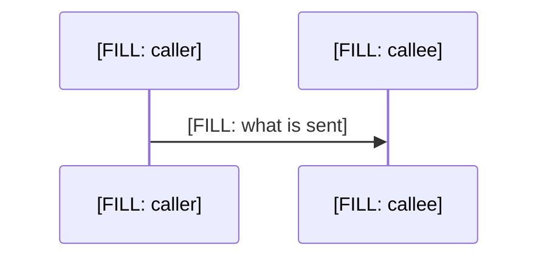

# Design — [FILL: feature name]

## Conclusion
[FILL: the recommended approach in one sentence, plus the key reason]

## Structure and interfaces
[FILL: modules, interfaces and state transitions that change, as behaviour a reviewer can judge. No code expressions here: those belong in the task documents. Link evidence in details/codebase.md]

## Flow
[FILL: draw what changes. Required when the change crosses a module or process boundary or any task changes a flow: a sequence diagram for calls across boundaries, a state diagram for changed states, or a before/after component diagram. Otherwise replace this section's body with one line: "No diagram: single module, no interaction changes."]

## Alternatives
| Option | Change scope | Risk | Maintainability | Verifiability | New dependencies |
|---|---|---|---|---|---|
| **A (recommended)** [FILL] | | | | | |
| B [FILL] | | | | | |

If there is only one real option, replace the table with one line: "No alternative: [reason]".

## What this design introduces
<!-- hr:introduces -->
[FILL: each new module, layer or dependency, with the requirement behind it, the existing thing in the repository you considered, and why it is not enough. If nothing is new, replace this paragraph and the table with one line: "Nothing new: [what the existing code already does]".]

| New part | Requirement or task | Existing thing considered | Why it is not used |
|---|---|---|---|
| [FILL] | | | |

## Other places that use it
<!-- hr:impact:start -->
<!-- hr:impact:end -->

## Tasks
<!-- hr:tasks:start -->
<!-- hr:tasks:end -->

## Remaining uncertainty
[FILL: what is still Unknown and how it could affect the result; 'none' if none]

## Decisions needed before implementation
[FILL: 'none' if none]
