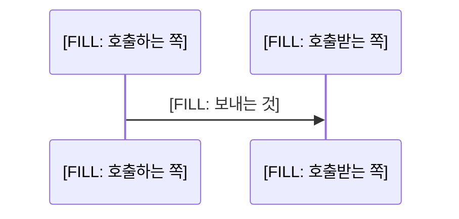

# 설계 — [FILL: 기능 이름]

## 결론
[FILL: 추천 방식 한 문장과 핵심 이유]

## 구조와 인터페이스
[FILL: 바뀌는 모듈, 인터페이스, 상태 전이를 검토자가 판단할 수 있는 동작으로. 코드 표현식은 여기 쓰지 않고 작업 문서에. 근거는 details/codebase.md 에 링크]

## 흐름
[FILL: 무엇이 바뀌는지 그리기. 변경이 모듈·프로세스 경계를 넘거나 흐름을 바꾸는 작업이 있으면 필수: 경계를 넘는 호출은 시퀀스 다이어그램, 상태가 바뀌면 상태 다이어그램, 또는 전/후 컴포넌트 다이어그램. 아니면 이 절의 내용을 한 줄로 대체: "다이어그램 없음: 단일 모듈, 상호작용 변경 없음."]

## 대안
| 방식 | 변경 범위 | 위험 | 유지보수성 | 검증 용이성 | 새 의존성 |
|---|---|---|---|---|---|
| **A (추천)** [FILL] | | | | | |
| B [FILL] | | | | | |

실제 대안이 하나뿐이면 표 대신 한 줄로: "대안 없음: [이유]".

## 작업
<!-- hr:tasks:start -->
<!-- hr:tasks:end -->

## 남은 불확실성
[FILL: 아직 모르는 것과 결과에 미칠 수 있는 영향. 없으면 '없음']

## 구현 전에 필요한 결정
[FILL: 없으면 '없음']
