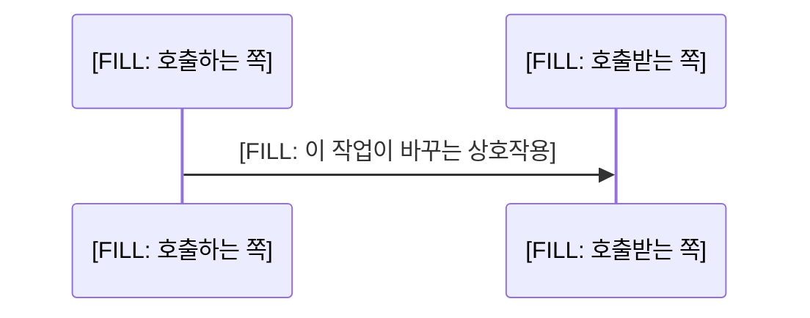

# [FILL: TASK-001] — [FILL: 작업 제목]

**목적:** [FILL: 이 작업이 책임지는 단 하나의 변경]
**선행 작업:** [FILL: 없으면 '없음'] · **위험:** [FILL: 낮음/보통/높음] · **사람 검토:** [FILL: 필수/선택]

## 인수 기준
- [FILL: AC-...]

<!-- flow:start -->
## 흐름

<!-- flow:end -->
## 변경 경계
[FILL: 이 작업이 바꿀 수 있는 모듈/경로. 그 밖은 `hr scope-change` 로 다시 승인]

## 검증
| 테스트 | 명령 / 절차 | 결과 |
|---|---|---|
| [FILL: TEST-...] | | 미실행 |

## 결과
[FILL: 구현 후: 커밋 SHA, 무엇이 바뀌었는지 1-2줄, 남은 문제]
