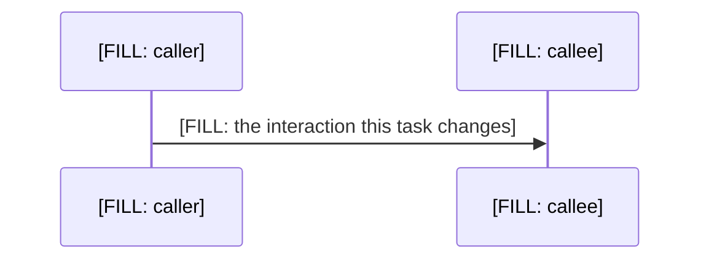

# [FILL: TASK-001] — [FILL: task title]

**Purpose:** [FILL: the single change this task is responsible for]
**Depends on:** [FILL: 'none' if none] · **Risk:** [FILL: low/medium/high] · **Human review:** [FILL: required/optional]

## Acceptance criteria
- [FILL: AC-...]

<!-- flow:start -->
## Flow

<!-- flow:end -->
## Change boundary
[FILL: modules/paths this task may change. Anything outside goes back through `hr scope-change`]

## Verification
| Test | Command / procedure | Result |
|---|---|---|
| [FILL: TEST-...] | | not run |

## Result
[FILL: after implementation: commit SHA, what changed in 1-2 lines, remaining issues]
