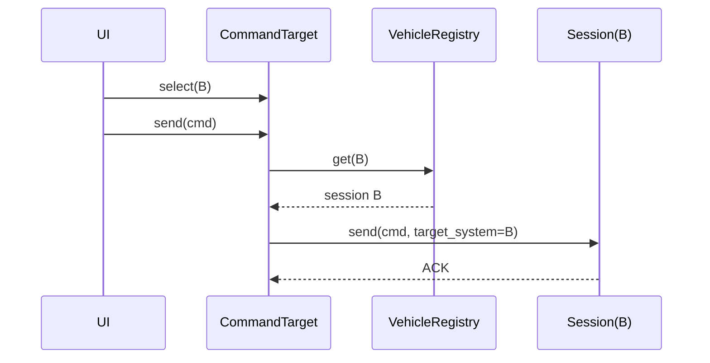

# Design — multi-vehicle connection and control

## Conclusion
Introduce a `VehicleRegistry` that owns one session per system_id, and make the command router resolve its target from an explicit selection. This is the smallest change that removes the global connection, which today is the only thing tying commands to "the" vehicle.

## Structure and interfaces
- `VehicleRegistry` (new, TASK-001): add/remove/get sessions by system_id; refuses duplicates.
- `CommandTarget` (new, TASK-002): holds the selected system_id; a switch requested while a command awaits its ACK is queued until the ACK or a 3 s timeout (DEC-003).
- Reconnection (TASK-003) works per session and never touches other sessions.
- The UI (TASK-004) reads the selection from `CommandTarget` and labels every command button with the target.

## Alternatives
| Option | Change scope | Risk | Maintainability | Verifiability | New dependencies |
|---|---|---|---|---|---|
| **A (recommended)** registry + explicit target | link, command, ui | medium | good: one owner per concern | unit + SITL e2e | none |
| B one GCS process per vehicle | packaging, ui | low in code, high in ops | poor: N windows, no shared view | hard | process manager |

## What this design introduces
<!-- hr:introduces -->
| New part | Requirement or task | Existing thing considered | Why it is not used |
|---|---|---|---|
| `VehicleRegistry` | REQ-001, TASK-001 | the module-level connection object in `src/link/conn.py` | it holds one connection, and the requirement is one session per system_id |
| `CommandTarget` | REQ-002, TASK-002 | the command helpers that read that connection directly | they have no selection to read, so a command cannot name its target |

## Other places that use it
<!-- hr:impact:start -->
<!-- hr:impact:end -->

## Tasks
<!-- hr:tasks:start -->
<!-- hr:tasks:end -->

## Remaining uncertainty
SITL timing with 4 instances on CI hardware is Unknown; TEST-011's +50 ms bound may need a dedicated runner.

## Decisions needed before implementation
None beyond approving this design.
